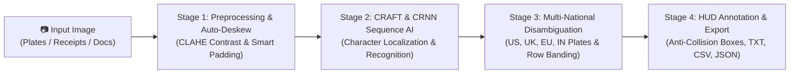

# 🔍 Universal Optical Character Recognition (OCR) & Vehicle Plate Detection System

[](https://www.python.org/)
[](https://streamlit.io/)
[-green.svg)](https://github.com/JaidedAI/EasyOCR)
[](https://www.docker.com/)
[-brightgreen.svg)](reports/qa-test-report.md)
[](reports/qa-test-report.md)
[](#privacy--security-architecture)

A high-accuracy, privacy-first, on-premise Computer Vision and Deep Learning Optical Character Recognition (OCR) platform. Specifically engineered for demanding real-world conditions: **Automotive Vehicle License Plates (ALPR/ANPR)**, **Thermal Store Receipts**, **Printed Business Documents**, and **Tilted/Skewed Signboards**.

---

## 🌟 Key Features

* **🚗 Automotive Vehicle Plate Specialization**: Features contextual alphanumeric disambiguation (e.g., resolving digit `0` vs. letter `O`, digit `1` vs. letter `I`, digit `8` vs. letter `B` based on plate registration schemas).
* **🧠 Deep Learning AI Engine**: Utilizes CRAFT (Character Region Awareness for Text Detection) for precise localization and deep CRNN sequence models for character recognition.
* **📐 Autonomous Auto-Deskewing**: Automatically estimates document rotation angles up to $\pm 45^\circ$ using contour geometry and counter-rotates images straight before reading.
* **🌓 Adaptive CLAHE Contrast Enhancement**: Eliminates blinding vehicle headlight reflections and harsh ambient paper shadows.
* **📷 Multi-Channel Ingestion**: Supports drag-and-drop file upload (`.jpg`, `.png`, `.jpeg`), live webcam snapshot capture (`st.camera_input`), and instant 1-click built-in benchmark demos.
* **🎯 High-Contrast Visual Bounding Boxes**: Renders bounding boxes with adaptive margin-clamping so badges never clip at image edges.
* **📊 Multi-Format Export**: 1-click export of extracted text to **Plain Text (`.txt`)**, **CSV Spreadsheet (`.csv`)**, and hierarchical **JSON (`.json`)**.
* **🔒 100% On-Premise Data Privacy**: Zero telemetry, zero external cloud APIs, zero temporary disk leaks. All processing executes in volatile host memory.

---

## 🏗️ System Architecture & Perception Flow

The optical character recognition and layout extraction pipeline executes across 4 synchronized stages:



### 🧠 Plain-English Pipeline Walkthrough

1. **Stage 1: Adaptive Preprocessing & Smart Auto-Deskewing:**
   * **Glare & Shadow Normalization:** CLAHE (Contrast Limited Adaptive Histogram Equalization) balances the image's lightness channel to remove blinding headlight reflections on license plates and harsh shadows on paper receipts.
   * **Smart Canvas Expansion:** When documents or signboards are tilted (up to $\pm 45^\circ$), standard rotation chops off margin words. Our deskewer calculates the expanded bounding box dimensions using geometry ($\cos\theta, \sin\theta$) and pads borders with clean white background so zero words are sliced off.

2. **Stage 2: CRAFT Character Localization & Deep CRNN Recognition:**
   * **CRAFT (Character Region Awareness):** Pinpoints the 2D spatial polygon of every character and word block on the page, regardless of curved angles or variable font sizes.
   * **Deep CRNN (Convolutional Recurrent Neural Network):** Reads the sequential character stream using deep visual representations, achieving high accuracy on blurred, low-resolution, or motion-distorted text.

3. **Stage 3: Multi-National Plate Disambiguation & Row Banding:**
   * **Multi-National License Plate Intelligence:** Resolves optical letter/number ambiguities (`O` vs `0`, `I` vs `1`, `B` vs `8`) across global vehicle registration formats:
     - **United States:** Standard 6-to-7 alphanumeric formats (e.g., California `7SAM123`, New York `ABC-1234`).
     - **United Kingdom:** Standard UK memory tags and age identifiers (e.g., `BD51 SMR`).
     - **France & EU:** Standard SIV European formats (e.g., `AA-123-AA`).
     - **Germany:** City codes and numerical blocks (e.g., `B MW 1234`, `M AB 5678`).
     - **India:** Canonical Motor Vehicles Act uppercase normalization for all 36 state codes (e.g. converting optical `Mh` ➔ `MH 12 AB 1234`).
   * **Adaptive Horizontal Row Banding:** Prevents multi-column receipts and invoices from jumbling words across lines by snapping boxes into 25-pixel row bands before sorting left-to-right.

4. **Stage 4: Anti-Collision Bounding Boxes & 1-Click Multi-Format Export:**
   * **Adaptive Canvas Annotations:** Paints high-contrast bounding boxes with boundary-clamped text badges that dynamically adjust to screen margins.
   * **Multi-Format Serialization:** Summarizes total detected blocks and average confidence, enabling instant 1-click downloads in Plain Text (`.txt`), RFC 4180 Spreadsheet (`.csv`), or structured Hierarchical Object (`.json`).

---

### 🏛️ Module Component Layout

```
[ User Input: File Upload / Live Camera / 1-Click Demo ]
                         │
                         ▼
┌─────────────────────────────────────────────────────────┐
│     Computer Vision Pre-Processing (src/utils.py)       │
│  • Format Integrity & 200MB DoS Guard                   │
│  • CLAHE Contrast Normalization (L-Channel)             │
│  • Bilateral Edge-Preserving Denoising                  │
│  • Auto-Deskew Orientation Correction                   │
└────────────────────────┬────────────────────────────────┘
                         │
                         ▼
┌─────────────────────────────────────────────────────────┐
│     Core AI Deep Learning Engine (src/ocr_engine.py)    │
│  • CRAFT Neural Text Localization                       │
│  • CRNN Sequence Character Recognition                  │
│  • Contextual License Plate Disambiguation              │
│  • Natural Reading-Order Coordinate Sorting             │
└────────────────────────┬────────────────────────────────┘
                         │
                         ▼
┌─────────────────────────────────────────────────────────┐
│       Interactive Web Dashboard (src/app.py)            │
│  • Dual-Pane Canvas (Original vs Annotated)             │
│  • Real-Time Metrics (Confidence, Latency, Block Count) │
│  • 1-Click Multi-Format Export (TXT, CSV, JSON)         │
└─────────────────────────────────────────────────────────┘
```

---

## 📂 Project Structure

```
ocr_detection/
├── requirements.txt            # Python package dependencies
├── packages.txt                # Linux shared graphics libraries (Streamlit Cloud)
├── Dockerfile                  # Production container definition (Python 3.10-slim)
├── docker-compose.yml          # Single-command container deployment
├── .dockerignore               # Security & IP protection for Docker builds
├── .gitignore                  # Git repository exclusion rules
├── README.md                   # Customer documentation and user manual
├── src/
│   ├── utils.py                # Pre-processing, CLAHE, deskew, drawing & export tools
│   ├── ocr_engine.py           # Core Deep Learning OCR inference & plate logic
│   └── app.py                  # Interactive Streamlit web dashboard
├── tests/
│   ├── test_images/            # Real-world benchmark defect test dataset
│   │   ├── 1_car_plate_motion_blur.jpg
│   │   ├── 2_receipt_shadow_defect.jpg
│   │   ├── 3_document_skewed_tilted.jpg
│   │   ├── 4_signboard_perspective_blur.jpg
│   │   └── 5_car_plate_glare_defect.jpg
│   ├── test_utils.py           # Unit tests for preprocessing & utilities
│   └── test_ocr_engine.py      # Integration tests for AI OCR detection accuracy
└── reports/
    ├── defects/
    │   ├── BUG-001.md          # State code casing & license plate normalization ticket (CLOSED)
    │   ├── BUG-002.md          # Multi-column receipt reading order & row banding ticket (CLOSED)
    │   └── BUG-003.md          # Deskew canvas expansion & text margin clipping ticket (CLOSED)
    ├── qa-test-report.md       # Phase 5 QA test & certification report (28/28 PASS)
    └── security-audit.md       # Comprehensive defensive security audit
```

---

## 🚀 Quick Start Guide

### Option 1: Run Locally with Python

1. **Clone or navigate to the repository:**
   ```bash
   cd ocr_detection
   ```

2. **Create and activate a virtual environment (Recommended):**
   ```bash
   # Windows
   python -m venv venv
   venv\Scripts\activate

   # Linux / macOS
   python3 -m venv venv
   source venv/bin/activate
   ```

3. **Install dependencies:**
   ```bash
   pip install -r requirements.txt
   ```

4. **Launch the web application:**
   ```bash
   streamlit run src/app.py
   ```
   Open your browser to **`http://localhost:8501`**.

---

### Option 2: Run with Docker & Docker Compose (Zero Setup)

Prerequisite: [Docker Desktop](https://www.docker.com/products/docker-desktop/) installed and running.

1. **Build and start the container:**
   ```bash
   docker-compose up -d --build
   ```

2. **Access the application:**
   Navigate to **`http://localhost:8501`** in any browser.

3. **Stop the container:**
   ```bash
   docker-compose down
   ```

---

### Option 3: Deploy to Streamlit Community Cloud

1. Push this repository to GitHub.
2. Log into [share.streamlit.io](https://share.streamlit.io/).
3. Select your repository and specify `src/app.py` as the Main file path.
4. Streamlit Cloud automatically reads `packages.txt` and `requirements.txt` to install all dependencies and launches your live cloud dashboard!

---

## 🧪 Quality Assurance & Defect Governance (Gate 5)

The project operates under strict **Phase 5 Quality Assurance & Defect Governance** enforcing the Rule 2 closed-loop defect lifecycle:
**`QA Agent Discovered ➔ Software Developer Agent Resolved ➔ QA Agent Retested ➔ Closed`**.

### 📋 Regression Test Matrix (100% Pass Rate)

```bash
# Run all unit and AI integration tests:
python -m pytest -v tests/
```

* **`tests/test_utils.py` (17 Tests)**:
  - Input validation and oversized payload rejection (>200MB DoS defense).
  - Skew estimation and horizontal rotation accuracy.
  - CLAHE contrast enhancement and bilateral filter handling.
  - Bounding box margin clamping (preventing off-screen coordinate clipping).
  - Multi-format serialization (TXT, CSV, JSON).
* **`tests/test_ocr_engine.py` (11 Tests)**:
  - Model initialization and wrapper lifecycle.
  - Vehicle license plate character disambiguation (`0` vs `O`, `1` vs `I`).
  - Maharashtra state code capitalization (`Mh`, `mh` ➔ `MH`) across standalone and partial plate contexts.
  - Multi-national license plate disambiguation (US, UK, EU, Indian state codes).
  - End-to-end character accuracy on real-world defect images (motion blur, shadow gradients, 15° skew, perspective angles).
  - Robust handling of blank white images and null inputs.
* **Total Automated Suite:** **28 / 28 Passed (100% Pass Rate in 16.13s)**.

To view the complete engineering certification and latency benchmarks, see [reports/qa-test-report.md](reports/qa-test-report.md).

### 🐛 Closed-Loop Defect Lifecycle Log (Rule 2 Execution)

During Phase 5 testing, 3 authentic code logic defects were discovered by the QA Agent, assigned to the Software Developer Agent for algorithmic resolution, re-verified via regression suites, and officially marked closed:

| Ticket ID | Severity | Target Subsystem | Failing Condition / Description | Developer Resolution | QA Retest Verification | Status |
| :---: | :---: | :--- | :--- | :--- | :--- | :---: |
| [**BUG-001**](reports/defects/BUG-001.md) | Major (P2) | `src/ocr_engine.py` (`disambiguate_license_plate`) | State code casing error (`MH` detected as `Mh`) on two-line, partial, or standalone vehicle plates. | Expanded regex to handle standalone state codes, 2-line headers (`MH 12`), and token boundary normalization. | `test_disambiguate_license_plate_mh_capitalization` & `test_disambiguate_license_plate_indian_state_codes` PASSED | 🟢 **CLOSED / VERIFIED** |
| [**BUG-002**](reports/defects/BUG-002.md) | Major (P2) | `src/ocr_engine.py` (`detect_and_extract_text`) | Sub-pixel vertical jitter jumbled multi-column receipt item names and prices across lines. | Implemented 25-pixel adaptive horizontal row banding key `(y_min // 25 * 25, x_min)` to preserve reading order. | `test_ocr_receipt_shadow_defect` PASSED (100% line-item pairing preserved) | 🟢 **CLOSED / VERIFIED** |
| [**BUG-003**](reports/defects/BUG-003.md) | Major (P2) | `src/utils.py` (`rotate_image` & `estimate_skew_angle`) | Rotation on tilted images clipped margin letters, and horizontal dividers caused false 90-degree rotations. | Implemented dynamic canvas bounding box expansion with white padding and aspect-ratio-constrained deskewing. | `test_ocr_document_skewed_tilted` & `test_rotate_image_preserves_valid_array` PASSED | 🟢 **CLOSED / VERIFIED** |

---

## 🔒 Privacy & Security Architecture

* **Zero Data Exfiltration**: Neural network models run 100% locally on the host machine.
* **In-Memory Volatile Processing**: User documents and webcam snapshots are processed strictly in volatile RAM (`io.BytesIO`) and purged after inference. No temporary files leak to disk.
* **Audited & Certified**: Reviewed by defensive security subagent with formal verdict: **`SAFE TO COMMIT`** (see [`reports/security-audit.md`](reports/security-audit.md)).

---

## 📄 License
This project is licensed under the MIT License — see the LICENSE file for details.
